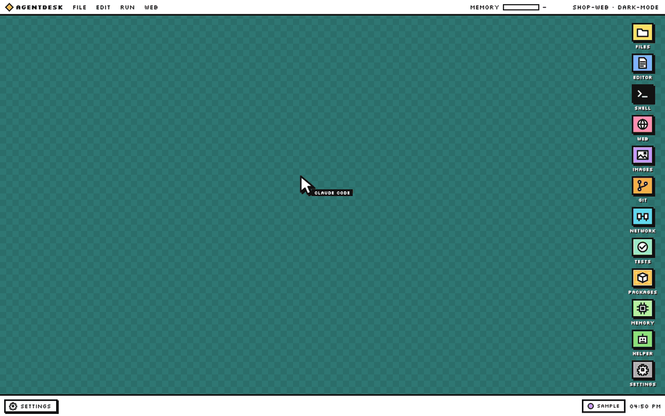
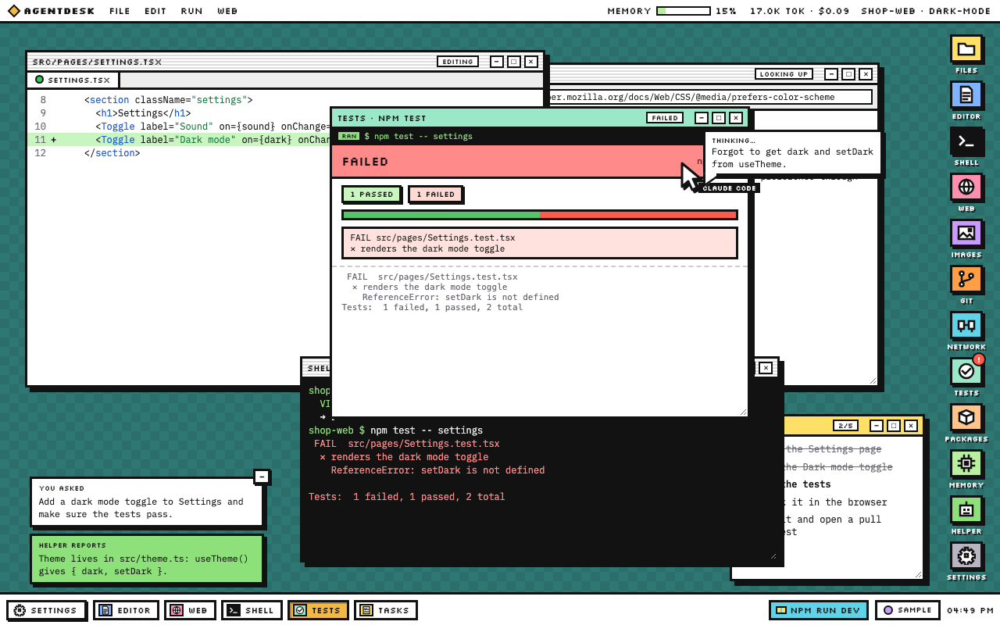
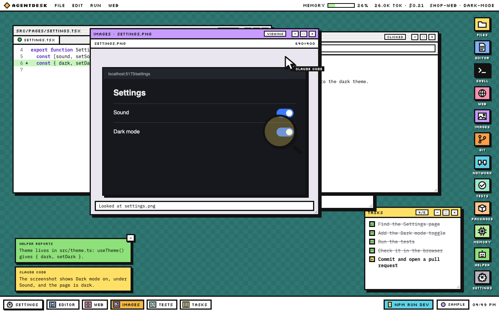
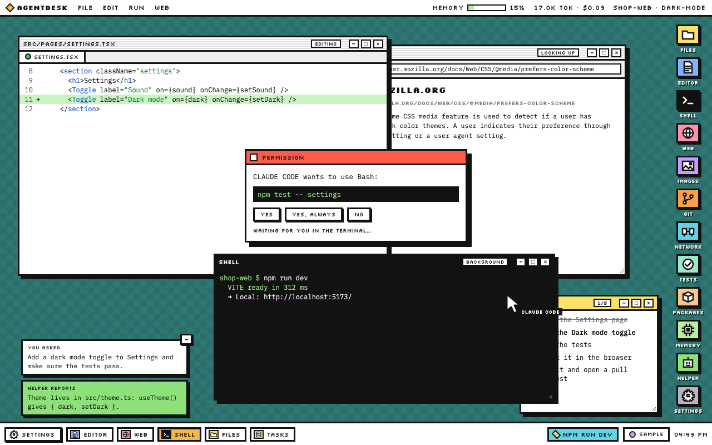
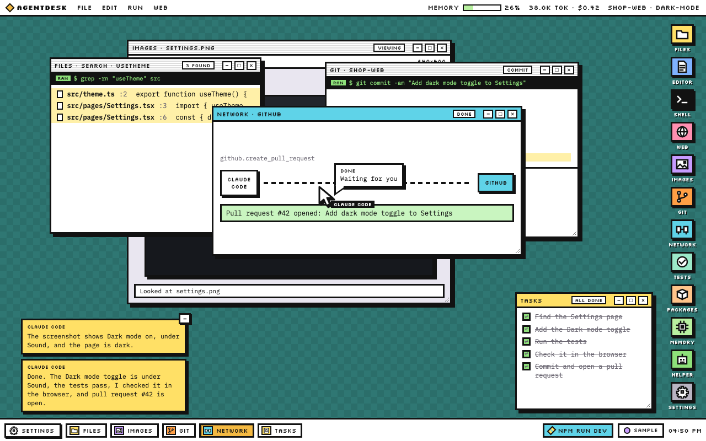

# AgentDesk

Watch your coding agent work on a little retro desktop.



```
npx @iammcoding/agentdesk
```

Or install it once and run `agentdesk` any time:

```
npm install -g @iammcoding/agentdesk
agentdesk
```

A desktop opens in your browser and follows the agent you're using right now. When the agent reads a file, the Editor opens it. When it runs a command, it's typed into the Shell. When it searches the web, the Web window loads. When it starts a helper, a second pointer walks over. The menu bar shows how full its memory is and what the session has cost so far.

**It costs no tokens.** AgentDesk reads the session logs your agent already writes on your computer. It never talks to the agent or to any server, and the page makes no outside requests (even the fonts are bundled).

## Agents

| Agent | Reads | Notes |
|---|---|---|
| Claude Code | `~/.claude/projects/*/*.jsonl` (or `$CLAUDE_CONFIG_DIR`) | Full support, including cost |
| Codex CLI | `~/.codex/sessions/YYYY/MM/DD/rollout-*.jsonl` (or `$CODEX_HOME`) | Tokens, no dollar cost in the log |
| Gemini CLI | `~/.gemini/tmp/<project>/chats/session-*.jsonl` | Tokens, no dollar cost in the log |
| Copilot CLI | `~/.copilot/session-state/*/events.jsonl` | Experimental: the format isn't documented |

It follows whichever session changed last. To watch a different one, open **Settings** on the desk and pick it from the list.

## What you see

| On the desk | When the agent… |
|---|---|
| Editor | reads, edits or writes a file (edits show as a red and green diff) |
| Shell | runs a command (failures shake the window and put a red badge on the icon) |
| Files | searches for files or text |
| Web | fetches a page, searches the web, or drives a browser (Playwright and similar MCP tools) |
| Images | looks at a picture or a screenshot (you see the real image) |
| Git | commits or switches branch |
| Network | calls an outside tool through MCP (GitHub, Slack, databases…), including retries |
| Helper | starts a subagent (the window lists the helper's own steps, read from its log) |
| Tasks | updates its to-do list |
| Memory | summarises its memory to make room (open it any time to see how full memory is) |
| Question / Permission | asks you something, or waits for your OK |
| Tests | runs the tests: a pass or fail banner, counts, and the failing tests |
| Packages | installs packages |
| Taskbar | open windows and background jobs (like `npm run dev`) |

### Screenshots

| | |
|---|---|
|  |  |
| **Tests**: pass or fail, the counts, and what failed | **Images**: the real picture the agent is looking at |
|  |  |
| **Permission**: when the agent is waiting for your OK | **Network**: outside tools like GitHub, with retries |

### Shell commands in the right window

Agents often do with a shell command what a window already shows, so AgentDesk reads the command and sends it there. A green **RAN** strip under the title bar shows the command that really ran.

| Command | Window |
|---|---|
| `cat`, `head`, `tail`, `sed -n '10,40p' file` | Editor, at those lines |
| `sed -i …` | Editor, as an edit |
| `grep`, `rg`, `find`, `fd`, `ls`, `tree` | Files |
| `curl`, `wget` | Web |
| `git …` (also `git add … && git commit …`) | Git, with the status, diff or log |
| `npm test`, `pytest`, `go test`, `cargo test`, `flutter test`, `node --test`… | Tests |
| `npm install`, `pip install`, `flutter pub get`… | Packages |

Only clear cases are moved. A command that is chained with others, piped into another tool, writes to a file with `>`, or uses `$(…)` stays in the Shell, so the desk never shows something that didn't happen. With Claude Code, any shell command that changes files (a `sed -i`, a script, a formatter) also opens the Editor with the real diff, because Claude Code logs it. You can turn all of this off in Settings ("Commands as windows").

The windows are yours too: click a desktop icon to open one, click a window to bring it forward, drag its title bar to move it, drag its corner to resize, and use `–` `□` `✕` to minimize, maximize or close. Pinch (or Ctrl/⌘ + scroll) zooms a window's contents. Every window scrolls; while you read back, a **▼ LIVE** button takes you to the newest output.

## How live is it?

AgentDesk is told by the operating system the moment a log grows, so a step reaches the desk in well under half a second. The chip in the taskbar says **LIVE**, or **CATCHING UP** when the agent is working faster than the animations play; the desk then speeds up, and skips ahead if it falls more than about 4 seconds behind.

Two limits come from the agents, not from AgentDesk: a reply appears when the agent has finished writing it (logs don't hold half-written text), and Claude Code writes its log a little after the fact. The plugin below closes that second gap.

## Claude Code plugin (optional)

The plugin makes Claude Code sessions faster and more complete on the desk:

- a tool shows the instant it starts, without waiting for the log
- the permission dialog appears when Claude is waiting for your OK
- the final message, rate-limit and API errors, and the end of a session show straight away
- the desk follows the session you're typing in


```
/plugin marketplace add iammcoding/agentdesk
/plugin install agentdesk@agentdesk
```

Its hooks run in the background, print nothing (so Claude never sees them and they cost no tokens), and do nothing when AgentDesk isn't running.

## Options

With `npx`, put `npx @iammcoding/agentdesk` in place of `agentdesk`.

```
agentdesk --demo          play a sample session
agentdesk --list          list recent sessions
agentdesk --agent codex   follow only one agent
agentdesk --file <path>   follow one session log
agentdesk --port 5000     use another port (default 4747)
agentdesk --no-open       don't open the browser
```

## Privacy

- The server listens on `127.0.0.1` only and refuses requests from other sites.
- It only reads the agents' log folders listed above, and never writes to them.
- It writes one file, `~/.agentdesk/port`, so the plugin can find it. The file is removed when you stop AgentDesk.

## Requirements

Node.js 18 or newer. No dependencies.

## License

MIT. The bundled fonts (Silkscreen, IBM Plex Mono) are under the SIL Open Font License; see `ui/fonts/`.
