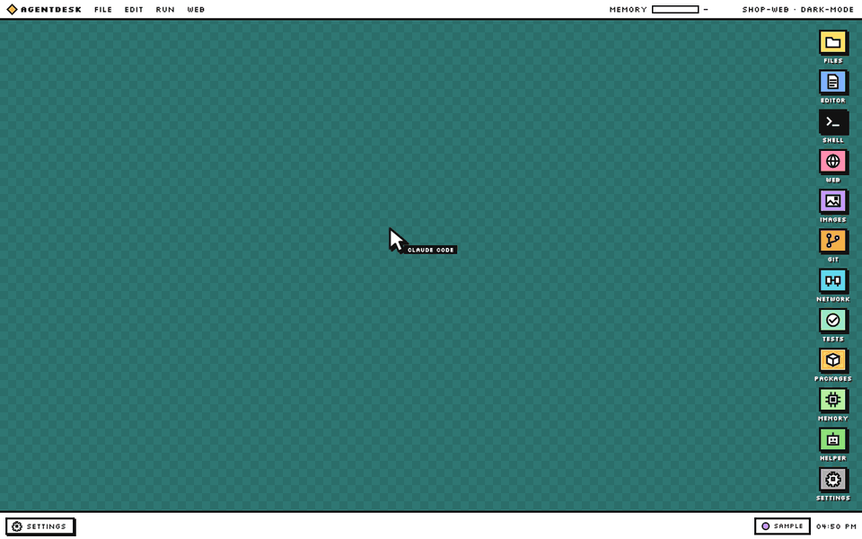

# AgentDesk

Watch Claude Code work on a little retro desktop in your browser.



When Claude reads a file, the Editor opens it. When it edits one, you see the change as a red and green diff. Commands run in a Shell window, test runs get a pass or fail banner, git and web pages and helper agents each get their own window, and the menu bar shows how full Claude's memory is and what the session has cost. You can move, resize, minimize and zoom the windows like a real desktop.

## What this plugin adds

- **`/agentdesk:open`**: tells you how to start AgentDesk next to your session.
- **An AgentDesk skill**: when you ask Claude how to watch what it is doing, it knows to point you to AgentDesk and how to run it.

This plugin has no hooks, no scripts and no servers. It runs nothing on your computer and sends nothing anywhere: it is instructions for Claude, nothing more.

## Start AgentDesk

AgentDesk itself is a small app from npm. Run it in another terminal window (Node.js 18 or newer):

```
npx @iammcoding/agentdesk
```

It reads the session logs Claude Code already writes on your computer, so it costs no tokens. It also follows Codex CLI and Gemini CLI.

## Privacy

AgentDesk runs entirely on your computer. Its server listens on 127.0.0.1 only, it reads the agents' log folders without changing them, and it keeps nothing on disk. See [PRIVACY.md](https://github.com/iammcoding/agentdesk/blob/main/PRIVACY.md).

## Source and support

https://github.com/iammcoding/agentdesk. Questions and bugs: https://github.com/iammcoding/agentdesk/issues

License: MIT.
